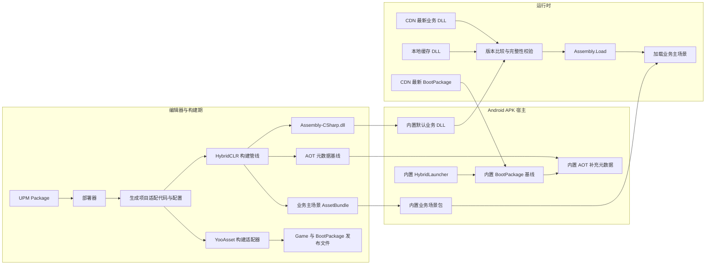
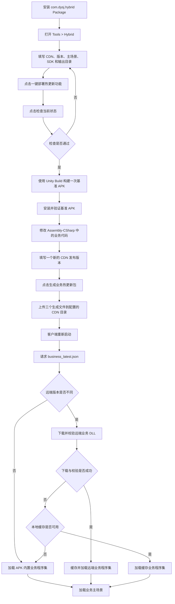

# DYSJ Hybrid Hot Update

用于在业务代码被外部项目重新转换、原有热更新接入被覆盖后，一键恢复当前项目的 HybridCLR 业务热更新能力。UPM 包名为 `com.dysj.hybrid`，当前方案面向 Unity 2022.1.x、Android、HybridCLR 8.11.0 和 YooAsset。

## 一、当前功能的设计方案

### 1. 设计目标

业务工程由其他项目转换而来，转换过程会覆盖 `Assets` 中的接入代码，因此不能依赖人工反复修改，也不能把核心工具本身放在容易被覆盖的业务目录中。本方案把稳定能力封装在 UPM Package `com.dysj.hybrid` 内，再由 Package 按模板重新生成项目侧适配文件。这样即使业务代码被整体替换，也可以根据同一套配置恢复热更新环境。

当前方案将 `Assembly-CSharp` 定义为业务热更新程序集。Android APK 只负责运行 IL2CPP/HybridCLR 宿主和启动器，不把 `Assembly-CSharp` 静态编译进 IL2CPP；启动器在运行时取得 DLL 后通过 `Assembly.Load` 加载，最后才进入业务主场景。

### 2. 使用的技术

| 技术 | 在本方案中的作用 |
| --- | --- |
| Unity UPM Package | 封装编辑器窗口、部署器、构建桥接、运行时启动器和代码模板，使工具可以独立安装和版本化。 |
| HybridCLR 8.11.0 | 让 IL2CPP Android 包能够在运行时加载 `Assembly-CSharp.dll`，并通过 `RuntimeApi.LoadMetadataForAOTAssembly` 补充 AOT 泛型元数据。 |
| Unity IL2CPP | 构建 Android 宿主程序和固定的 AOT 代码基线；业务 DLL 在该宿主上解释执行。 |
| YooAsset 2.3.x | 构建业务 `Game` 包和独立 `BootPackage`；后者负责启动界面场景的内置基线、缓存版本和 CDN 更新。 |
| AssetBundle | 将业务主场景单独构建为 `hybrid_main_scene.bundle` 放入 `StreamingAssets`，避免主场景在业务 DLL 加载前被 Unity 直接加载。 |
| UnityWebRequest | 请求 CDN 清单和业务 DLL，同时负责从 Android `StreamingAssets` 读取内置场景包。 |
| JSON + SHA-256 | 清单记录版本、平台、文件名、长度和哈希；生成时写入，加载前校验，防止错包或不完整文件被执行。 |
| `persistentDataPath` 缓存 | 保存最近一次校验成功的远端业务 DLL，在网络或 CDN 异常时提供回退。 |

### 3. 总体架构



架构分为两条互相约束的链路：

- **宿主构建链路**：接管 Unity Android Build，执行 HybridCLR `GenerateAll`，分析泛型引用，生成裁剪后的 AOT 补充元数据、默认业务 DLL 和业务场景包，并将它们固化进 APK。这个结果构成不可随 DLL 单独变更的 AOT 基线。
- **业务发布链路**：只重新编译 `Assembly-CSharp` 并生成 AOT 泛型引用分析；工具会检查新 DLL 所需的 AOT 程序集是否都存在于 APK 基线中。检查通过后，才构建 YooAsset `Game` 包并导出 CDN 文件；出现新增 AOT 依赖时会阻止发布并要求重新构建 APK。
- **启动界面发布链路**：`HybridLauncher` 永久内置 APK，`HybridBootstrap` 作为纯视觉场景进入 `BootPackage`。启动界面布局、字体、图片、材质和动画可以单独发布，下载完成后在下一次启动生效。

### 4. 运行时设计

`HybridLauncher` 是 APK 的唯一首场景。它先从“完整缓存版本、APK 内置版本”中选择可用的 `BootPackage`，加载其中的 `HybridBootstrap` 视觉场景，然后校验并加载 APK 中的 AOT 补充元数据，再从“远端 DLL、本地缓存 DLL、APK 默认 DLL”中选择一份有效业务代码：

- 已完整缓存的新 `BootPackage` 优先；缓存无效时自动回退 APK 内置基线。
- 启动界面显示后与业务代码检查并行下载新版本；切入 `Main` 前确保下载操作结束，避免业务层重置 YooAsset 时中断缓存。完整下载并校验成功后才记录版本，下次启动生效，过程中仍只显示现有 Loading 界面。

- CDN 版本与 APK 内置版本不同时，下载远端 DLL 并校验平台、长度和 SHA-256；成功后写入缓存并加载。
- CDN 版本与 APK 内置版本相同时，直接使用 APK 默认 DLL。
- CDN 请求、下载或校验失败时，尝试已校验的本地缓存；缓存也不可用时使用 APK 默认 DLL。
- DLL 完整性校验并加载成功后，从内置 AssetBundle 打开业务主场景。

这种设计保证了更新失败不影响基础版本启动，同时确保业务场景不会在动态程序集接管前执行。

### 5. 对项目进行的修改

| 修改位置 | 修改内容与目的 |
| --- | --- |
| `Packages/manifest.json` | 引用 `com.dysj.hybrid`，并在缺失时安装指定的 HybridCLR 8.11.0 Package。 |
| `ProjectSettings/HybridSettings.asset` | 持久化 CDN、发布版本、Android SDK、主场景、类型校验、超时和输出目录等配置。 |
| `ProjectSettings/HybridCLRSettings.asset` | 启用 HybridCLR，将 `Assembly-CSharp` 设置为热更新程序集，配置补充元数据程序集和生成目录。 |
| `Assets/Editor/HybridCLR/` | 生成项目专用构建管线和 asmdef，负责宿主基线生成、DLL 编译、AOT 依赖检查及发布文件导出。 |
| `Assets/_Native/Editor/BuildYooAssetsAndroid.cs` | 生成 Android YooAsset 构建适配器；该目录属于转换工具的原生保护区，避免再次转换时被覆盖。 |
| `Assets/_Native/Runtime/Hybrid/HybridLauncher.unity` | 生成极小的 APK 内置入口，仅运行 AOT 启动控制器。 |
| `Assets/_Native/Runtime/Hybrid/HybridBootstrap.unity` | 生成可由 `BootPackage` 更新的纯视觉启动界面。 |
| `Assets/Res/HybridCLR/` | 保存构建阶段生成的默认业务 DLL、清单、AOT 元数据及哈希清单。 |
| `Assets/Resources/HybridCLR/` | 将上一项同步为 APK 内置资源，供启动器通过 `Resources.Load` 读取。 |
| `Assets/StreamingAssets/HybridCLR/hybrid_main_scene.bundle` | 保存独立构建的业务主场景包，避免该场景引用导致 `Assembly-CSharp` 被静态打进 IL2CPP。 |
| `Assets/AssetBundleCollectorSetting.asset` | 在 `Game` 下维护 `hybridclr` 组，并幂等创建只收集 `HybridBootstrap` 场景的 `BootPackage`。 |
| `Assets/link.xml` | 移除对 `Assembly-CSharp` 的 AOT 保留项，并确保保留 `HybridCLR.RuntimeApi`，防止动态业务程序集被提前编译进宿主或被 Unity Linker 漏掉。 |
| Build Settings | 将 `HybridLauncher` 放在首位；实际构建 Android 时只把 Launcher 交给 Unity，启动视觉场景由 BootPackage 加载，业务主场景由内置 AssetBundle 加载。 |
| Player Settings 与 Android Gradle | 强制 Android 使用 IL2CPP，校验外部 SDK，并修正 `compileSdk`、Build Tools 和 `sdk.dir`。 |

### 6. 发布文件协议

默认发布根目录是 `D:/Project/dysj_client_native/Bundles/Android/Game`，实际输出到 `<根目录>/<发布版本>/BusinessCode`：

```text
Assembly-CSharp_<版本>.dll.bytes
business_latest.json
business_<版本>.json
```

`business_latest.json` 是客户端查询入口，版本清单用于历史追溯。两个清单都记录程序集名称、版本、Android 平台、文件长度、SHA-256 和生成时间。

## 二、操作流程图



首次接入时，必须完整执行“部署、检查、构建基准 APK”；之后只修改可热更新的业务代码时，通常只需要设置新版本、生成业务热更新包并上传 CDN，不需要重新构建 APK。若修改了 AOT 代码、原生插件、启动逻辑、Player Settings 或资源结构，则需要重新构建基准 APK。

只修改 `HybridBootstrap` 的布局或视觉资源时，填写新版本后点击“生成启动界面资源包”，把 `Bundles/Android/BootPackage/<版本>` 中的全部文件上传到启动配置对应的 CDN 目录。客户端后台完整缓存后，下次启动使用新界面，不需要重新构建 APK。

## 三、项目注意点

1. 本工具是当前 DYSJ 项目的热更新恢复和发布工具，不是从零创建游戏框架的脚手架。全新空项目不能只安装本 Package 就直接运行。
2. 目标项目需要预先包含 YooAsset 2.3.x、`Res.PackageConfig`、名为 `Game` 的资源包配置、有效的业务主场景，以及可编译的业务代码和资源。
3. 当前只支持 Android，要求 Android SDK、目标 Platform、Build Tools 和许可证均有效，并使用 IL2CPP 构建后端。
4. 当前热更新业务程序集固定为 `Assembly-CSharp`。只有编译进该程序集且不依赖新增 AOT 能力的业务逻辑，才适合仅通过 DLL 热更新。
5. 第一次部署后必须先构建一次基准 APK。该步骤会生成并固化与包体匹配的 AOT 元数据和默认业务程序集，不能跳过。
6. AOT 基线必须与已安装的 APK 匹配。只发布业务 DLL 时，不要重新生成或替换宿主 APK 所对应的 AOT 基线；涉及 AOT 变化时应重新构建 APK。
7. `HybridLauncher` 必须保持 Unity 的唯一 APK 入口；`HybridBootstrap` 只能作为 BootPackage 场景，不要把业务主场景改回 Unity 的直接首场景。
8. 每次发布都必须使用新的 CDN 发布版本。若版本号与 APK 内置版本或上一次远端版本相同，客户端不会下载新的业务 DLL。
9. 发布时应把生成目录中的 DLL、`business_latest.json` 和版本清单一并上传到 CDN 配置目录，并确认 URL 可公开访问。替换同名文件后需要刷新 CDN 缓存，或等待缓存过期。
10. 不要删除 APK 内置的默认业务程序集和清单，它们是首次启动、离线运行以及远端更新失败时的最终回退保障。
11. `HybridBootstrap` 不得引用 `Assembly-CSharp` 业务脚本。UI、TMP/SDF 字体、图片、材质和动画资源可以引用，工具会把依赖一起收进 BootPackage。
12. 稳定项目建议通过 Git 标签安装，而不是长期跟随 `main`：

```text
https://github.com/gensisboss/dysj-Hybrid.git#v1.1.0
```
