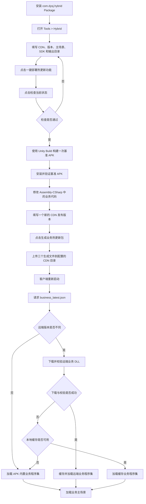

# DYSJ Hybrid Hot Update

用于在业务代码被外部项目重新转换、原有热更新接入被覆盖后，一键恢复当前项目的 HybridCLR 业务热更新能力。UPM 包名为 `com.dysj.hybrid`，当前方案面向 Unity 2022.1.x、Android、HybridCLR 8.11.0 和 YooAsset。

## 一、当前功能的设计方案

### 1. 工具入口与职责

安装 Package 后，通过 Unity 菜单 `Tools > Hybrid` 打开工具窗口。窗口按实际操作顺序提供三个主操作：

1. **一键部署热更新功能**：恢复项目被业务转换流程覆盖的 HybridCLR 接入代码和配置。
2. **检查当前状态**：检查依赖、配置、生成文件和基准 APK 构建条件是否完整。
3. **生成业务热更新包**：编译业务程序集、构建 YooAsset `Game` 包，并导出可上传到 CDN 的业务代码文件。

按钮会根据项目状态自动启用或禁用。点击不可用的按钮时，工具会显示当前缺失的文件、错误配置、编译状态或尚未生成基准 APK 等原因。

### 2. 一键部署内容

部署过程会自动完成以下工作：

- 配置 HybridCLR，并为 HybridCLR 8.11.0 应用 Unity 2022.1 兼容处理。
- 生成 `Assets/Editor/HybridCLR/HybridCLRBuildPipeline.cs`。
- 生成 `Assets/_Native/Editor/BuildYooAssetsAndroid.cs`。
- 创建并配置 AOT 启动场景 `Assets/_Native/Runtime/Hybrid/HybridBootstrap.unity`。
- 配置 YooAsset 的业务程序集收集规则。
- 配置 Android IL2CPP 构建参数、业务主场景、启动类型和校验类型。
- 接管 Unity 的 Android Build 流程，在 APK 中写入与当前包体匹配的默认业务程序集和 AOT 元数据基线。

### 3. 运行时加载策略

APK 始终携带一套可独立启动的默认业务程序集。应用启动时先进入 AOT 启动场景，再按以下顺序选择业务代码：

1. 校验 APK 内置的默认业务程序集。
2. 请求 CDN 上的 `business_latest.json`。
3. 远端版本与 APK 内置版本一致时，直接使用 APK 内置程序集。
4. 远端版本不一致时，下载对应 DLL，并校验文件长度和 SHA-256。
5. 下载和校验成功后缓存文件，加载远端业务程序集。
6. 远端请求或校验失败时，优先尝试本地缓存；缓存不可用时回退到 APK 内置程序集。
7. 业务程序集接管后，再加载配置的业务主场景。

因此，CDN 暂时不可用不会直接导致应用无法启动，但 APK 内置基线必须保持完整。

### 4. 发布产物

默认生成文件根目录为：

```text
D:/Project/dysj_client_native/Bundles/Android/Game
```

实际发布目录为 `<生成文件根目录>/<发布版本>/BusinessCode`，其中包含：

```text
Assembly-CSharp_<版本>.dll.bytes
business_latest.json
business_<版本>.json
```

`business_latest.json` 是客户端查询的最新版本入口；带版本号的清单用于保留可追溯的历史发布信息。

## 二、操作流程图



首次接入时，必须完整执行“部署、检查、构建基准 APK”；之后只修改可热更新的业务代码时，通常只需要设置新版本、生成业务热更新包并上传 CDN，不需要重新构建 APK。若修改了 AOT 代码、原生插件、启动逻辑、Player Settings 或资源结构，则需要重新构建基准 APK。

## 三、项目注意点

1. 本工具是当前 DYSJ 项目的热更新恢复和发布工具，不是从零创建游戏框架的脚手架。全新空项目不能只安装本 Package 就直接运行。
2. 目标项目需要预先包含 YooAsset 2.3.x、`Res.PackageConfig`、名为 `Game` 的资源包配置、有效的业务主场景，以及可编译的业务代码和资源。
3. 当前只支持 Android，要求 Android SDK、目标 Platform、Build Tools 和许可证均有效，并使用 IL2CPP 构建后端。
4. 当前热更新业务程序集固定为 `Assembly-CSharp`。只有编译进该程序集且不依赖新增 AOT 能力的业务逻辑，才适合仅通过 DLL 热更新。
5. 第一次部署后必须先构建一次基准 APK。该步骤会生成并固化与包体匹配的 AOT 元数据和默认业务程序集，不能跳过。
6. AOT 基线必须与已安装的 APK 匹配。只发布业务 DLL 时，不要重新生成或替换宿主 APK 所对应的 AOT 基线；涉及 AOT 变化时应重新构建 APK。
7. 启动场景必须先加载动态业务程序集，再进入业务主场景。不要把业务主场景改回 Unity 的直接首场景，否则手机会继续执行包内静态代码。
8. 每次发布都必须使用新的 CDN 发布版本。若版本号与 APK 内置版本或上一次远端版本相同，客户端不会下载新的业务 DLL。
9. 发布时应把生成目录中的 DLL、`business_latest.json` 和版本清单一并上传到 CDN 配置目录，并确认 URL 可公开访问。替换同名文件后需要刷新 CDN 缓存，或等待缓存过期。
10. 不要删除 APK 内置的默认业务程序集和清单，它们是首次启动、离线运行以及远端更新失败时的最终回退保障。
11. 稳定项目建议通过 Git 标签安装，而不是长期跟随 `main`：

```text
https://github.com/gensisboss/dysj-Hybrid.git#v1.0.1
```
